# Case cards — sq5_big_red_recent__in_all6 — PRACTICE 2020–24, HINT only (not evidence; 2025–26 sealed)

Prices `universe_2020_survivors.parquet` sha `fb9bbe69…ef337` (verified), rows 2020-01-01..2024-12-31 only (asserted). Signals from frozen HINT panel (story_q.py `…bfbca9`).
Question `sq5_big_red_recent`; base filter `all6`; horizons [5, 10, 21]; primary 10d; N=20; seed=7. Answers use bars < D; entry = open D; exit = open D+h; net of 30bp/side.
Sample is **stratified** (half winners, half losers at the primary horizon), so the card win rate is 50% by design — use the population line below for the real rate.
Control = random same-day stock-day passing the same base filter with `sq5_big_red_recent` = NO. Excess = card net − control net.

## Population summary (all matching stock-days)

| h | n | win% | mean net% | median net% | mean excess vs same-day all% |
|---|---|---|---|---|---|
| 5 | 47,915 | 43.1 | 0.58 | -0.60 | +0.73 |
| 10 | 47,227 | 44.3 | 1.12 | -0.70 | +0.96 |
| 21 | 46,704 | 44.5 | 1.52 | -0.90 | +0.96 |

## Cards

| # | ticker | D | yes | net5% | ex5% | 5d | net10% | ex10% | 10d | net21% | ex21% | 21d | ctl | chart |
|---|---|---|---|---|---|---|---|---|---|---|---|---|---|---|
| 1 | MLKN | 2020-07-01 | q1_lower_highs3 q4_below_mid_5of10 q5_big_red_recent | -12.28 | -11.65 | LOSE | -7.15 | -9.49 | LOSE | -5.68 | -3.88 | LOSE | VXZ | 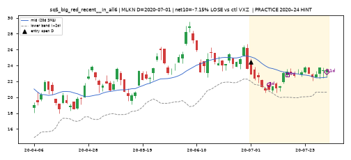 |
| 2 | CLLS | 2020-07-13 | q5_big_red_recent | 4.6 | 3.55 | WIN | -3.81 | -5.58 | LOSE | 4.6 | 2.12 | WIN | RRBI | 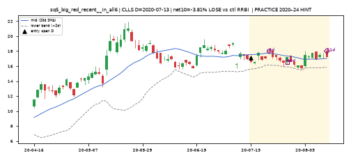 |
| 3 | AZIO | 2020-10-19 | q2_higher_lows3 q5_big_red_recent q8_above_last_red_high | 13.04 | 14.37 | WIN | -12.87 | -12.52 | LOSE | 15.31 | 14.68 | WIN | PIM | 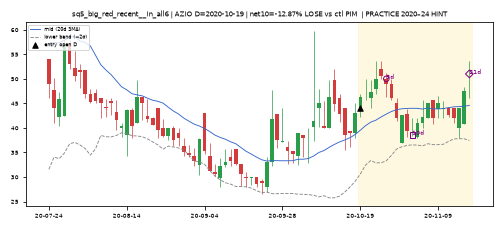 |
| 4 | PGR | 2020-10-23 | q3_shrinking_green3 q5_big_red_recent q6_dip_vol_lower | -4.4 | -3.76 | LOSE | 2.94 | 3.58 | WIN | -2.11 | -1.45 | LOSE | TFLO | 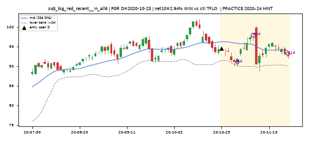 |
| 5 | QUBT | 2020-12-07 | q2_higher_lows3 q3_shrinking_green3 q5_big_red_recent | 30.71 | 22.86 | WIN | 218.59 | 219.12 | WIN | 137.78 | 130.57 | WIN | NRP | 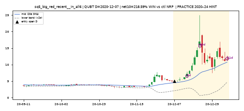 |
| 6 | NLY | 2021-02-26 | q4_below_mid_5of10 q5_big_red_recent q6_dip_vol_lower | -0.72 | 0.85 | LOSE | 2.64 | -1.02 | WIN | 6.47 | 10.42 | WIN | RLMD | 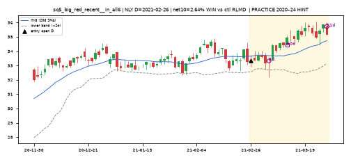 |
| 7 | SDOT | 2021-03-02 | q5_big_red_recent | -6.34 | 14.8 | LOSE | 8.01 | 14.86 | WIN | -10.44 | 11.59 | LOSE | SDEV | 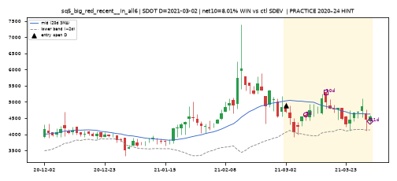 |
| 8 | CSIQ | 2021-07-15 | q1_lower_highs3 q2_higher_lows3 q5_big_red_recent | 1.77 | 1.57 | WIN | 1.29 | 3.49 | WIN | 2.68 | 37.41 | WIN | GNLN | 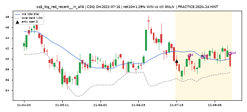 |
| 9 | DCGO | 2021-09-27 | q5_big_red_recent | -0.5 | 13.68 | LOSE | -0.3 | 15.73 | LOSE | -0.1 | 7.91 | LOSE | BKSY | 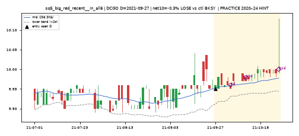 |
| 10 | GRI | 2021-12-17 | q2_higher_lows3 q5_big_red_recent | -0.93 | -4.96 | LOSE | -0.93 | -13.38 | LOSE | -2.76 | -12.58 | LOSE | GNK | 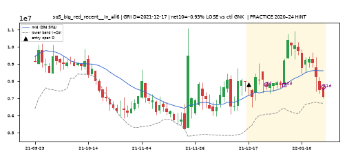 |
| 11 | WEN | 2022-02-25 | q2_higher_lows3 q4_below_mid_5of10 q5_big_red_recent q7_lowerbb_reclaim | -2.92 | 2.06 | LOSE | -6.04 | -0.64 | LOSE | -2.47 | -3.23 | LOSE | DIOD | 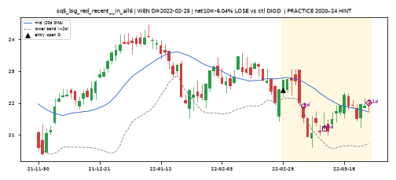 |
| 12 | VICI | 2022-04-08 | q5_big_red_recent | 3.94 | 6.36 | WIN | 6.28 | 11.44 | WIN | -1.68 | 14.36 | LOSE | TSQ | 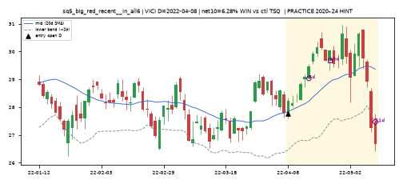 |
| 13 | YEXT | 2022-06-21 | q2_higher_lows3 q5_big_red_recent | 2.44 | 6.62 | WIN | -5.91 | 2.11 | LOSE | -10.85 | 0.3 | LOSE | TCBX | 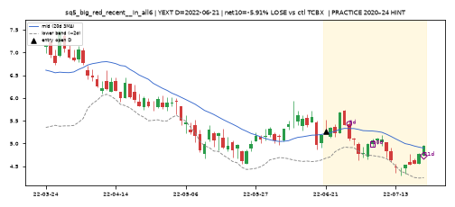 |
| 14 | LEXX | 2023-10-06 | q1_lower_highs3 q5_big_red_recent q6_dip_vol_lower | 16.07 | 21.2 | WIN | 22.73 | 23.66 | WIN | 62.73 | 66.25 | WIN | AIMD | 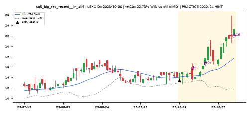 |
| 15 | RDHL | 2023-12-08 | q2_higher_lows3 q3_shrinking_green3 q5_big_red_recent | -9.9 | -12.29 | LOSE | -1.38 | -3.56 | LOSE | 0.95 | -11.8 | WIN | JFIN | 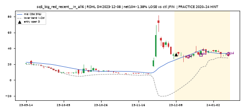 |
| 16 | ATYR | 2024-08-09 | q2_higher_lows3 q5_big_red_recent q6_dip_vol_lower | 6.5 | 3.7 | WIN | 1.59 | -3.6 | WIN | 3.77 | -8.14 | WIN | SKT | 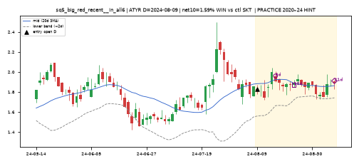 |
| 17 | GEF | 2024-09-13 | q1_lower_highs3 q2_higher_lows3 q4_below_mid_5of10 q5_big_red_recent q7_lowerbb_reclaim | 4.22 | 2.22 | WIN | 4.04 | 2.33 | WIN | 2.49 | 3.44 | WIN | ASH | 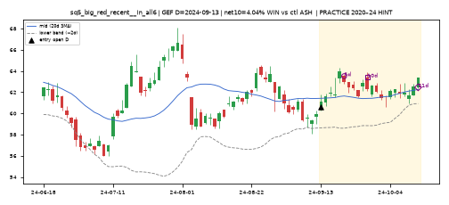 |
| 18 | MDIA | 2024-10-31 | q4_below_mid_5of10 q5_big_red_recent | -0.6 | 3.99 | LOSE | -12.6 | 7.02 | LOSE | 9.0 | 60.52 | WIN | STLN | 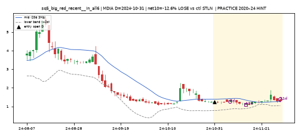 |
| 19 | PCT | 2024-11-20 | q1_lower_highs3 q3_shrinking_green3 q4_below_mid_5of10 q5_big_red_recent q8_above_last_red_high | 12.23 | 22.64 | WIN | 6.9 | 23.24 | WIN | -15.6 | 6.81 | LOSE | BDRY | 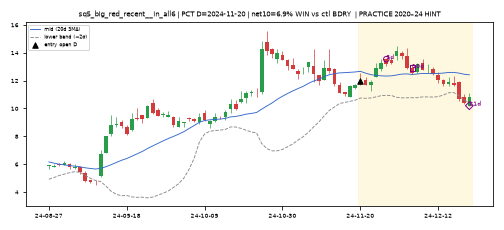 |
| 20 | RPAY | 2024-11-21 | q4_below_mid_5of10 q5_big_red_recent | 1.75 | 3.43 | WIN | -4.93 | -4.24 | LOSE | -4.43 | -0.41 | LOSE | KARS | 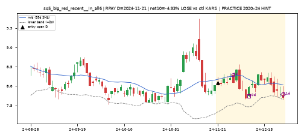 |
