# Case cards — sq7_lowerbb_reclaim__in_all6 — PRACTICE 2020–24, HINT only (not evidence; 2025–26 sealed)

Prices `universe_2020_survivors.parquet` sha `fb9bbe69…ef337` (verified), rows 2020-01-01..2024-12-31 only (asserted). Signals from frozen HINT panel (story_q.py `…bfbca9`).
Question `sq7_lowerbb_reclaim`; base filter `all6`; horizons [5, 10, 21]; primary 10d; N=20; seed=7. Answers use bars < D; entry = open D; exit = open D+h; net of 30bp/side.
Sample is **stratified** (half winners, half losers at the primary horizon), so the card win rate is 50% by design — use the population line below for the real rate.
Control = random same-day stock-day passing the same base filter with `sq7_lowerbb_reclaim` = NO. Excess = card net − control net.

## Population summary (all matching stock-days)

| h | n | win% | mean net% | median net% | mean excess vs same-day all% |
|---|---|---|---|---|---|
| 5 | 23,053 | 42.4 | 0.84 | -0.60 | +0.80 |
| 10 | 22,880 | 44.8 | 1.63 | -0.54 | +1.20 |
| 21 | 22,725 | 45.1 | 1.95 | -0.60 | +1.04 |

## Cards

| # | ticker | D | yes | net5% | ex5% | 5d | net10% | ex10% | 10d | net21% | ex21% | 21d | ctl | chart |
|---|---|---|---|---|---|---|---|---|---|---|---|---|---|---|
| 1 | HLT | 2020-11-02 | q2_higher_lows3 q3_shrinking_green3 q4_below_mid_5of10 q5_big_red_recent q6_dip_vol_lower q7_lowerbb_reclaim q8_above_last_red_high | 27.12 | 18.76 | WIN | 23.8 | 12.45 | WIN | 17.92 | -5.29 | WIN | WDC | 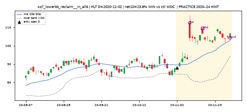 |
| 2 | NVT | 2021-01-29 | q4_below_mid_5of10 q6_dip_vol_lower q7_lowerbb_reclaim q8_above_last_red_high q9_breakdown_vol | 4.88 | -0.23 | WIN | 0.33 | -6.41 | WIN | 20.42 | 21.53 | WIN | NTLA | 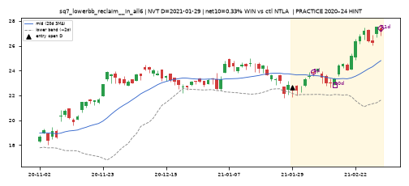 |
| 3 | DRIP | 2021-04-30 | q3_shrinking_green3 q6_dip_vol_lower q7_lowerbb_reclaim | -7.21 | -3.76 | LOSE | -6.92 | -5.31 | LOSE | -24.79 | -35.58 | LOSE | RDI | 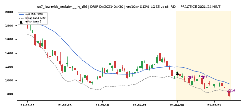 |
| 4 | XTNT | 2021-08-31 | q1_lower_highs3 q4_below_mid_5of10 q6_dip_vol_lower q7_lowerbb_reclaim | -4.6 | -1.14 | LOSE | -4.6 | 3.36 | LOSE | -11.8 | -3.3 | LOSE | UNP | 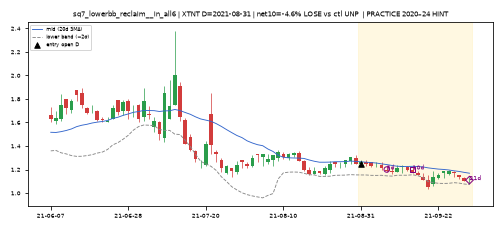 |
| 5 | CSTE | 2021-11-24 | q4_below_mid_5of10 q7_lowerbb_reclaim q8_above_last_red_high q9_breakdown_vol | -13.57 | -11.78 | LOSE | -8.34 | -7.81 | LOSE | -9.79 | -15.37 | LOSE | MAYS | 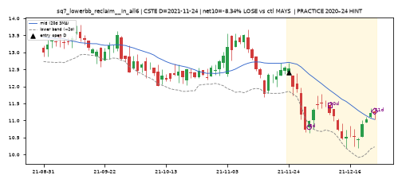 |
| 6 | CLIR | 2021-12-02 | q2_higher_lows3 q7_lowerbb_reclaim | -7.56 | -56.89 | LOSE | -11.99 | -46.47 | LOSE | -13.26 | -26.3 | LOSE | PPSI | 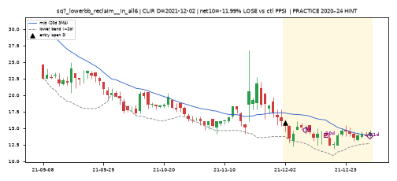 |
| 7 | GILT | 2022-01-31 | q1_lower_highs3 q4_below_mid_5of10 q7_lowerbb_reclaim | 2.2 | 0.38 | WIN | 8.33 | 6.15 | WIN | 8.47 | 14.63 | WIN | TEVA | 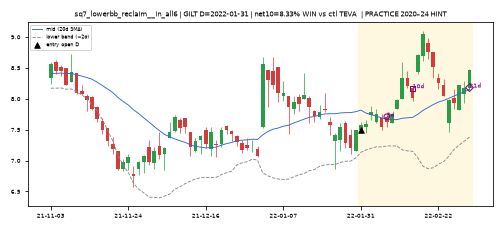 |
| 8 | NUGT | 2022-02-11 | q1_lower_highs3 q4_below_mid_5of10 q6_dip_vol_lower q7_lowerbb_reclaim | 26.88 | 19.66 | WIN | 28.7 | 9.04 | WIN | 32.65 | -36.41 | WIN | FNGD | 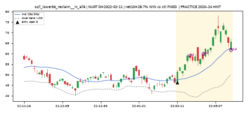 |
| 9 | ONL | 2022-03-03 | q4_below_mid_5of10 q7_lowerbb_reclaim | -2.86 | 6.97 | LOSE | 2.32 | 12.44 | WIN | -17.34 | -10.72 | LOSE | AIRT | 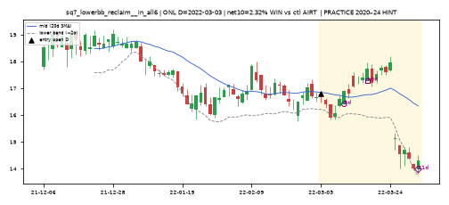 |
| 10 | DLX | 2022-03-11 | q2_higher_lows3 q4_below_mid_5of10 q6_dip_vol_lower q7_lowerbb_reclaim | 8.82 | -2.68 | WIN | 2.61 | 68.65 | WIN | -4.0 | 73.82 | LOSE | GRI | 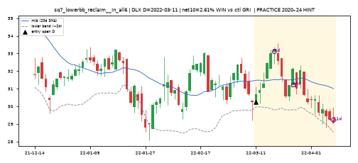 |
| 11 | AKA | 2022-06-14 | q2_higher_lows3 q3_shrinking_green3 q6_dip_vol_lower q7_lowerbb_reclaim | -12.77 | -15.09 | LOSE | -9.8 | -12.04 | LOSE | -19.29 | -18.25 | LOSE | CTEC | 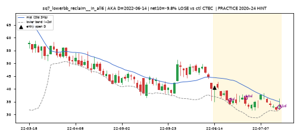 |
| 12 | MI | 2022-11-23 | q7_lowerbb_reclaim | 4.66 | 5.16 | WIN | -3.89 | 1.09 | LOSE | -24.55 | -21.86 | LOSE | SPRU | 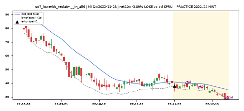 |
| 13 | MITK | 2023-02-13 | q7_lowerbb_reclaim | -1.32 | -11.2 | LOSE | -6.99 | -17.75 | LOSE | -8.85 | -16.44 | LOSE | URGN | 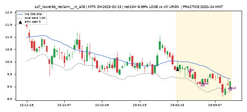 |
| 14 | INM | 2023-05-11 | q4_below_mid_5of10 q6_dip_vol_lower q7_lowerbb_reclaim q8_above_last_red_high | -7.1 | -2.11 | LOSE | 4.28 | 1.78 | WIN | 3.47 | 2.0 | WIN | ABAT | 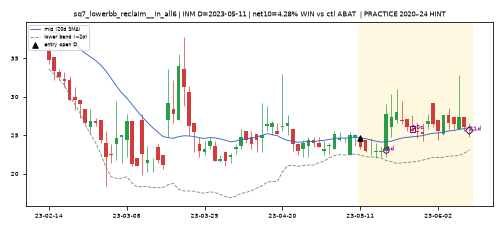 |
| 15 | ARES | 2023-05-12 | q3_shrinking_green3 q4_below_mid_5of10 q7_lowerbb_reclaim q8_above_last_red_high | 1.22 | -0.31 | WIN | 2.94 | 5.28 | WIN | 13.81 | -0.69 | WIN | JBTM | 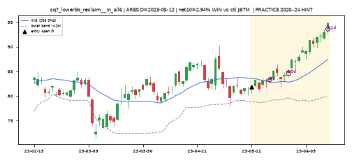 |
| 16 | PHAR | 2023-10-03 | q4_below_mid_5of10 q5_big_red_recent q7_lowerbb_reclaim q9_breakdown_vol | -1.52 | -12.72 | LOSE | -5.71 | -40.52 | LOSE | -2.02 | -85.28 | LOSE | SRRK | 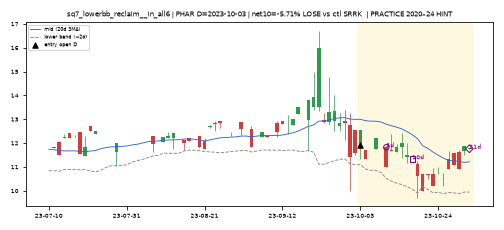 |
| 17 | HUYA | 2024-01-05 | q4_below_mid_5of10 q7_lowerbb_reclaim q9_breakdown_vol | 0.84 | 13.74 | WIN | -7.52 | 14.04 | LOSE | -2.91 | 10.12 | LOSE | BTDR | 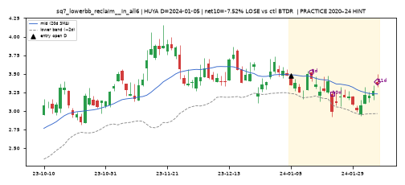 |
| 18 | NPCE | 2024-04-18 | q6_dip_vol_lower q7_lowerbb_reclaim q8_above_last_red_high | -6.09 | -2.86 | LOSE | 0.63 | -6.12 | WIN | -38.75 | -50.49 | LOSE | SDA | 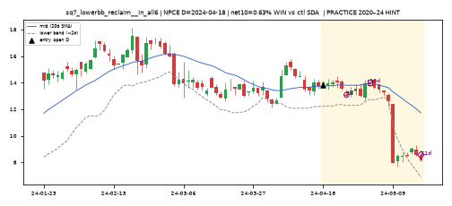 |
| 19 | SYNA | 2024-11-19 | q7_lowerbb_reclaim | 11.78 | 1.6 | WIN | 11.53 | 9.1 | WIN | 4.84 | -38.33 | WIN | BEEP | 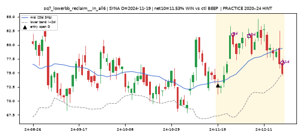 |
| 20 | KZIA | 2024-11-29 | q1_lower_highs3 q3_shrinking_green3 q4_below_mid_5of10 q7_lowerbb_reclaim | -21.24 | -20.07 | LOSE | -34.59 | -14.73 | LOSE | -49.89 | -21.13 | LOSE | ILLR | 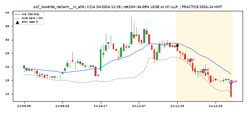 |
