# Case cards — sq8_above_last_red_high__all_names — PRACTICE 2020–24, HINT only (not evidence; 2025–26 sealed)

Prices `universe_2020_survivors.parquet` sha `fb9bbe69…ef337` (verified), rows 2020-01-01..2024-12-31 only (asserted). Signals from frozen HINT panel (story_q.py `…bfbca9`).
Question `sq8_above_last_red_high`; base filter `none`; horizons [5, 10, 21]; primary 10d; N=20; seed=7. Answers use bars < D; entry = open D; exit = open D+h; net of 30bp/side.
Sample is **stratified** (half winners, half losers at the primary horizon), so the card win rate is 50% by design — use the population line below for the real rate.
Control = random same-day stock-day passing the same base filter with `sq8_above_last_red_high` = NO. Excess = card net − control net.

## Population summary (all matching stock-days)

| h | n | win% | mean net% | median net% | mean excess vs same-day all% |
|---|---|---|---|---|---|
| 5 | 2,895,679 | 41.2 | -0.44 | -0.53 | -0.43 |
| 10 | 2,889,584 | 44.7 | -0.17 | -0.44 | -0.49 |
| 21 | 2,862,079 | 48.2 | 0.36 | -0.23 | -0.60 |

## Cards

| # | ticker | D | yes | net5% | ex5% | 5d | net10% | ex10% | 10d | net21% | ex21% | 21d | ctl | chart |
|---|---|---|---|---|---|---|---|---|---|---|---|---|---|---|
| 1 | ENPH | 2020-05-20 | q2_higher_lows3 q8_above_last_red_high | -18.29 | -16.24 | LOSE | -23.63 | -16.13 | LOSE | -33.0 | -42.92 | LOSE | VNET | 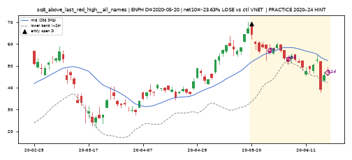 |
| 2 | RKDA | 2020-08-06 | q1_lower_highs3 q3_shrinking_green3 q4_below_mid_5of10 q6_dip_vol_lower q7_lowerbb_reclaim q8_above_last_red_high | 0.19 | -1.13 | WIN | -11.68 | -10.92 | LOSE | -20.39 | -17.39 | LOSE | NMM | 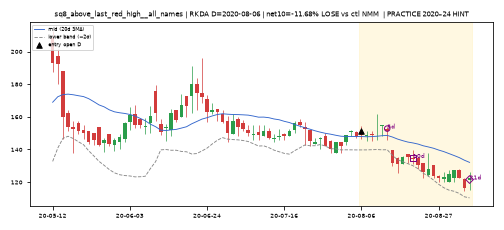 |
| 3 | ALG | 2021-02-17 | q8_above_last_red_high | 5.91 | -1.23 | WIN | 3.04 | -4.5 | WIN | 4.7 | -3.29 | WIN | PFGC | 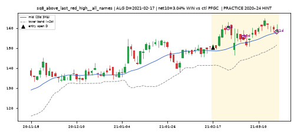 |
| 4 | BW | 2021-04-06 | q5_big_red_recent q6_dip_vol_lower q7_lowerbb_reclaim q8_above_last_red_high | -11.92 | -11.7 | LOSE | -24.21 | -22.98 | LOSE | -6.26 | -7.25 | LOSE | TRNS | 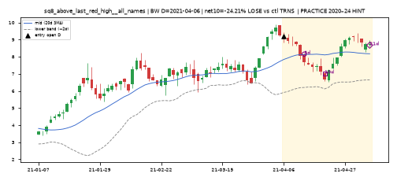 |
| 5 | REK | 2021-06-18 | q4_below_mid_5of10 q8_above_last_red_high | -0.6 | -0.97 | LOSE | -1.14 | -2.65 | LOSE | -3.71 | -2.89 | LOSE | MGV | 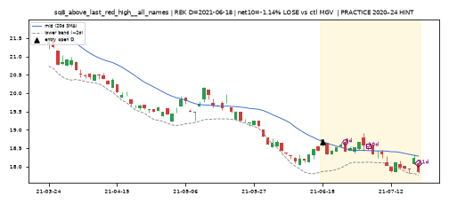 |
| 6 | CMF | 2021-06-29 | q4_below_mid_5of10 q8_above_last_red_high | -0.5 | -0.46 | LOSE | -0.31 | 2.45 | LOSE | -0.06 | 8.55 | LOSE | RXT | 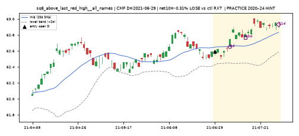 |
| 7 | VRT | 2021-10-21 | q3_shrinking_green3 q4_below_mid_5of10 q7_lowerbb_reclaim q8_above_last_red_high | 6.68 | 3.63 | WIN | 10.53 | 21.47 | WIN | 13.1 | 21.51 | WIN | SPSC | 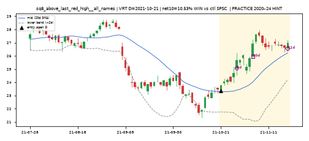 |
| 8 | CARG | 2022-06-21 | q4_below_mid_5of10 q5_big_red_recent q7_lowerbb_reclaim q8_above_last_red_high | 4.48 | 0.39 | WIN | 0.55 | -0.14 | WIN | 8.02 | 0.89 | WIN | DLB | 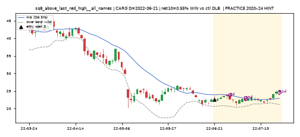 |
| 9 | SJM | 2022-09-26 | q1_lower_highs3 q2_higher_lows3 q4_below_mid_5of10 q6_dip_vol_lower q8_above_last_red_high | -1.83 | -6.07 | LOSE | -1.89 | -8.22 | LOSE | 2.74 | -6.79 | WIN | ARKR | 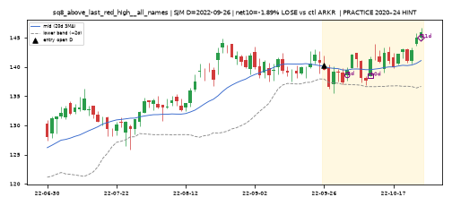 |
| 10 | GILT | 2022-10-26 | q4_below_mid_5of10 q6_dip_vol_lower q7_lowerbb_reclaim q8_above_last_red_high | 5.19 | 5.43 | WIN | -6.21 | -4.77 | LOSE | 6.42 | 6.06 | WIN | EXEL | 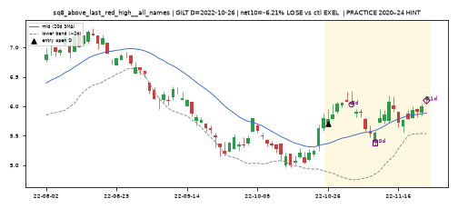 |
| 11 | CBAN | 2023-05-19 | q1_lower_highs3 q4_below_mid_5of10 q6_dip_vol_lower q7_lowerbb_reclaim q8_above_last_red_high | -2.43 | -7.49 | LOSE | 1.34 | -2.8 | WIN | 4.45 | 2.79 | WIN | EPV | 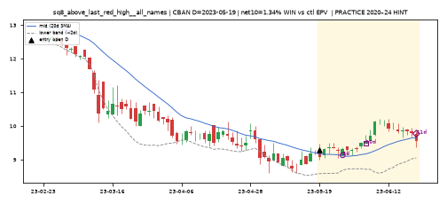 |
| 12 | ETO | 2023-05-30 | q1_lower_highs3 q5_big_red_recent q6_dip_vol_lower q7_lowerbb_reclaim q8_above_last_red_high | 0.94 | -1.02 | WIN | 2.57 | -12.17 | WIN | 2.66 | -17.19 | WIN | TILE | 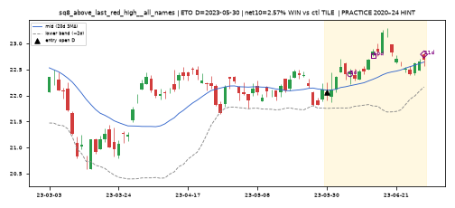 |
| 13 | FHB | 2023-10-10 | q4_below_mid_5of10 q6_dip_vol_lower q7_lowerbb_reclaim q8_above_last_red_high | 0.23 | 9.73 | WIN | -3.63 | 15.85 | LOSE | 0.45 | 14.2 | WIN | UCTT | 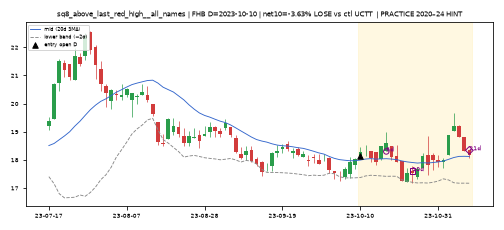 |
| 14 | CMBT | 2023-10-11 | q8_above_last_red_high | -0.09 | 10.24 | LOSE | 0.02 | 16.73 | WIN | 0.7 | 19.17 | WIN | ACB | 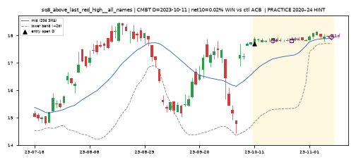 |
| 15 | BA | 2023-11-03 | q1_lower_highs3 q4_below_mid_5of10 q7_lowerbb_reclaim q8_above_last_red_high q9_breakdown_vol | -0.08 | 0.46 | LOSE | 6.8 | 5.65 | WIN | 19.78 | 17.79 | WIN | KHYB | 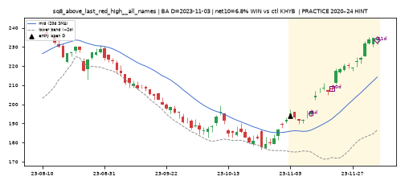 |
| 16 | CRON | 2024-06-28 | q1_lower_highs3 q4_below_mid_5of10 q6_dip_vol_lower q7_lowerbb_reclaim q8_above_last_red_high | -6.09 | -3.53 | LOSE | 0.67 | -1.34 | WIN | 0.67 | -0.64 | WIN | SM | 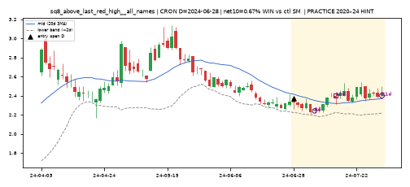 |
| 17 | GDXU | 2024-08-21 | q1_lower_highs3 q7_lowerbb_reclaim q8_above_last_red_high | -7.24 | -7.31 | LOSE | -18.0 | -12.54 | LOSE | 3.17 | -1.91 | WIN | BTCW | 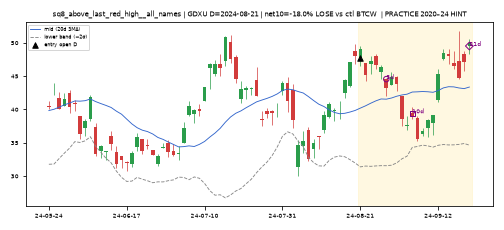 |
| 18 | PAGP | 2024-09-16 | q4_below_mid_5of10 q6_dip_vol_lower q7_lowerbb_reclaim q8_above_last_red_high | 0.15 | -65.92 | WIN | -1.51 | -69.24 | LOSE | -1.24 | -70.64 | LOSE | SMSI | 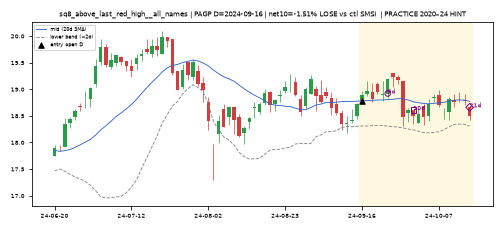 |
| 19 | BLX | 2024-09-16 | q2_higher_lows3 q6_dip_vol_lower q8_above_last_red_high | 6.44 | 20.16 | WIN | 3.62 | 18.15 | WIN | 9.39 | 28.85 | WIN | BLNE | 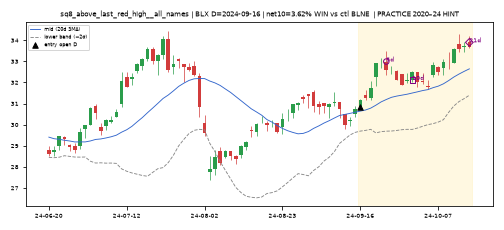 |
| 20 | IVR | 2024-09-17 | q1_lower_highs3 q6_dip_vol_lower q7_lowerbb_reclaim q8_above_last_red_high | -2.46 | -11.56 | LOSE | 2.36 | -20.94 | WIN | -5.1 | -36.1 | LOSE | IPX | 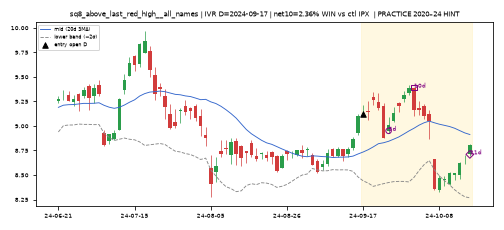 |
